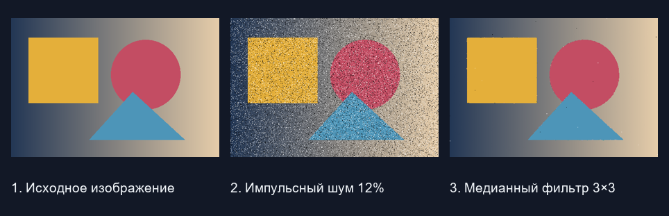

# Пиксельная — обработка изображений

Учебное локальное веб-приложение на Python, Django и OpenCV. Позволяет добавлять шум, применять фильтры, выделять границы оператором Собеля и сравнивать результаты по гистограммам и метрикам качества.



## Локальный запуск

Проверено с Python 3.12. Выполните команды из корня проекта.

```cmd
python -m venv .venv
.venv\Scripts\python.exe -m pip install -r requirements.txt
.venv\Scripts\python.exe manage.py runserver 127.0.0.1:8010
```

На macOS и Linux используйте `.venv/bin/python` вместо `.venv\Scripts\python.exe`.
Откройте http://127.0.0.1:8010/. Для остановки нажмите Ctrl+C.
Загруженные изображения, сессии и локальный ключ Django создаются в `runtime/`.
Для своего ключа задайте переменную окружения `DJANGO_SECRET_KEY`.

## Интерфейс

1. Выбрать файл — он загрузится автоматически.
2. Выбрать метод: описание и параметры обновятся автоматически.
3. Настроить параметры. При смене варианта описание обновится автоматически.
4. Нажать «Выполнить обработку».
5. Скачать PNG либо использовать результат как вход следующего метода.

Вычисления выполняются на сервере в Python. База данных не требуется. История хранится в файловой сессии, изображения — в `runtime/images`. Рабочая копия ограничена 640 пикселями по длинной стороне. Результат можно использовать как вход следующей операции, сохраняя исходный эталон для сравнения.

## Структура

- `manage.py` — запуск Django.
- `config/settings.py` — настройки, шаблоны, файлы, сессии.
- `config/urls.py` — адреса страниц и скачивания.
- `editor/catalog.py` — каталог 16 методов, параметры и пояснения.
- `editor/views.py` — загрузка, проверка параметров, состояние сессии, вызов алгоритмов, вывод, скачивание.
- `editor/processing.py` — обработка изображений, гистограммы и метрики.
- `templates/index.html` — Django-шаблон интерфейса.
- `static/styles.css` — оформление.
- `requirements.txt` — библиотеки Python.

## Путь PNG

HTML-форма `multipart/form-data` → HTTP POST → `request.FILES` → `decode_image` → Pillow декодирует PNG → RGB-массив NumPy → `process_image` → обработанный массив → `encode_png` → PNG в `runtime/images` → HTML `` показывает результат → `download_result` отдаёт PNG как вложение.

Pillow отвечает за чтение/сохранение, NumPy — за массивы и FFT, OpenCV — за преобразования цвета, фильтры, градиенты, Кэнни и Оцу. Контрастирование, гамма, шум, k-means и метрики реализованы в Python-коде. Гистограммы формируются как SVG на сервере.

## Метрики

MSE и PSNR считаются по RGB. SSIM — среднее по окнам яркости 8×8 с K1=0.01, K2=0.03, L=255. Метрики показываются для сглаживания, медианы, резкости и частотной фильтрации. Без отдельного эталона используется первоначально загруженное изображение. Для оценки восстановления оно должно быть чистым и соответствовать той же сцене.

FFT использует уменьшение до степеней двойки не более 256×256. После фильтрации результат масштабируется обратно; это влияет на метрики. HSV, YCbCr и Lab выводятся в условных цветах с нормированными компонентами.
